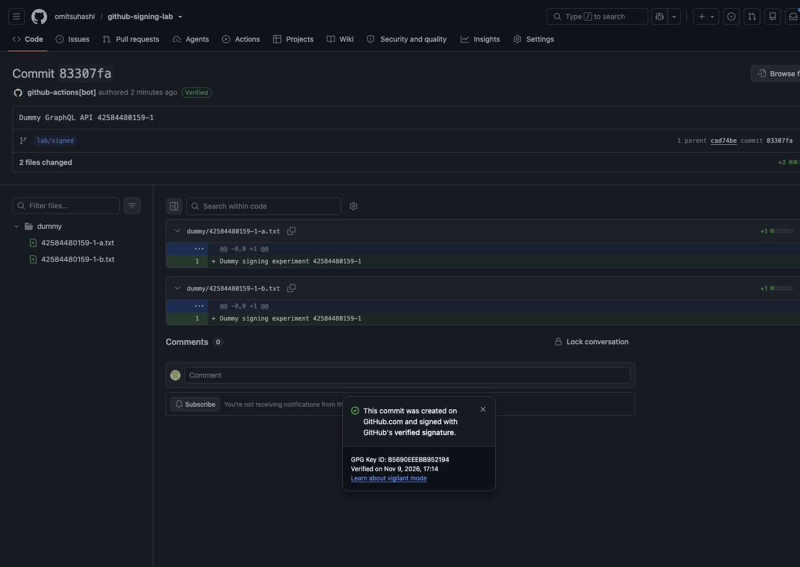
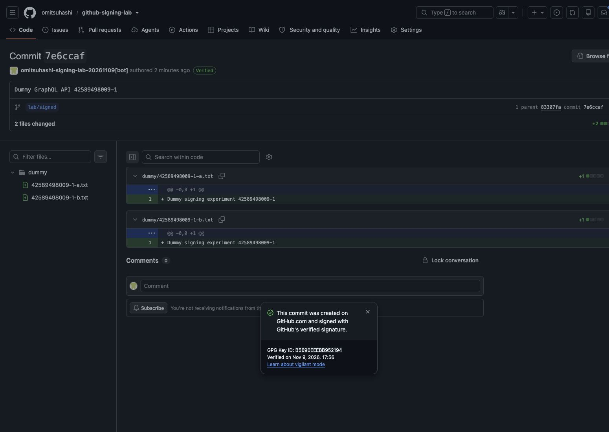
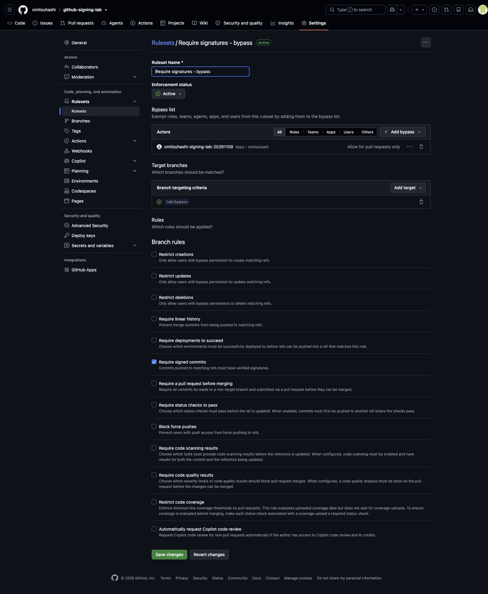
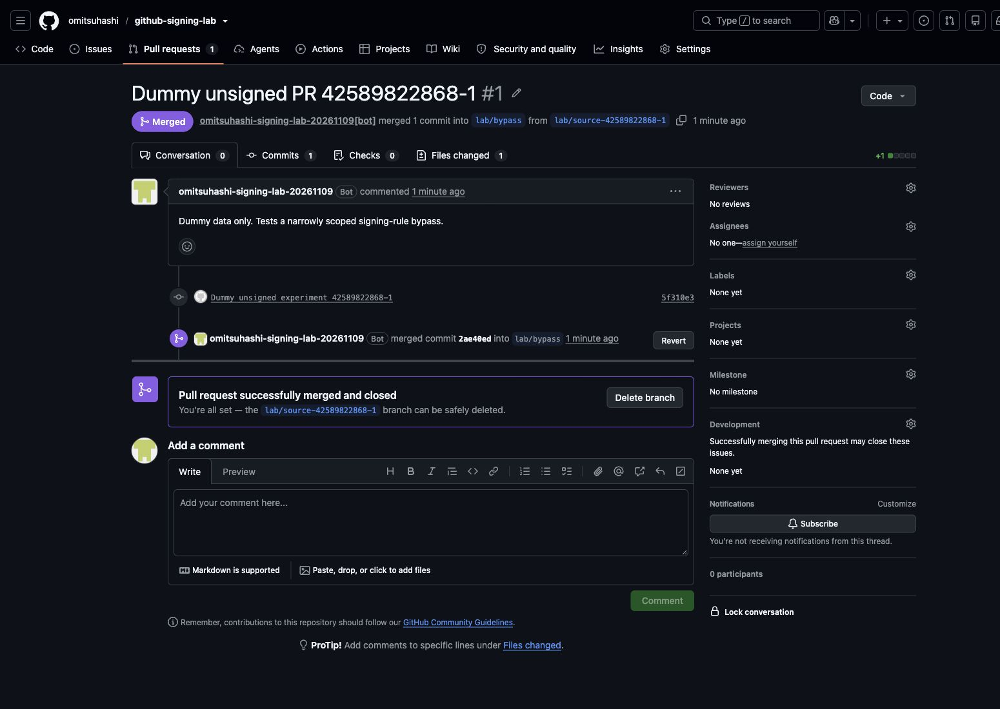
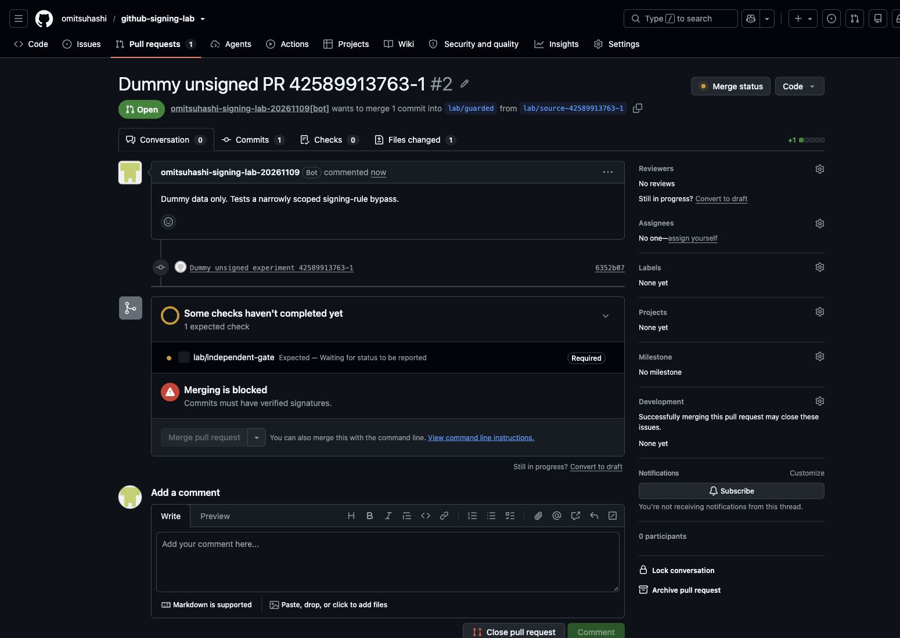
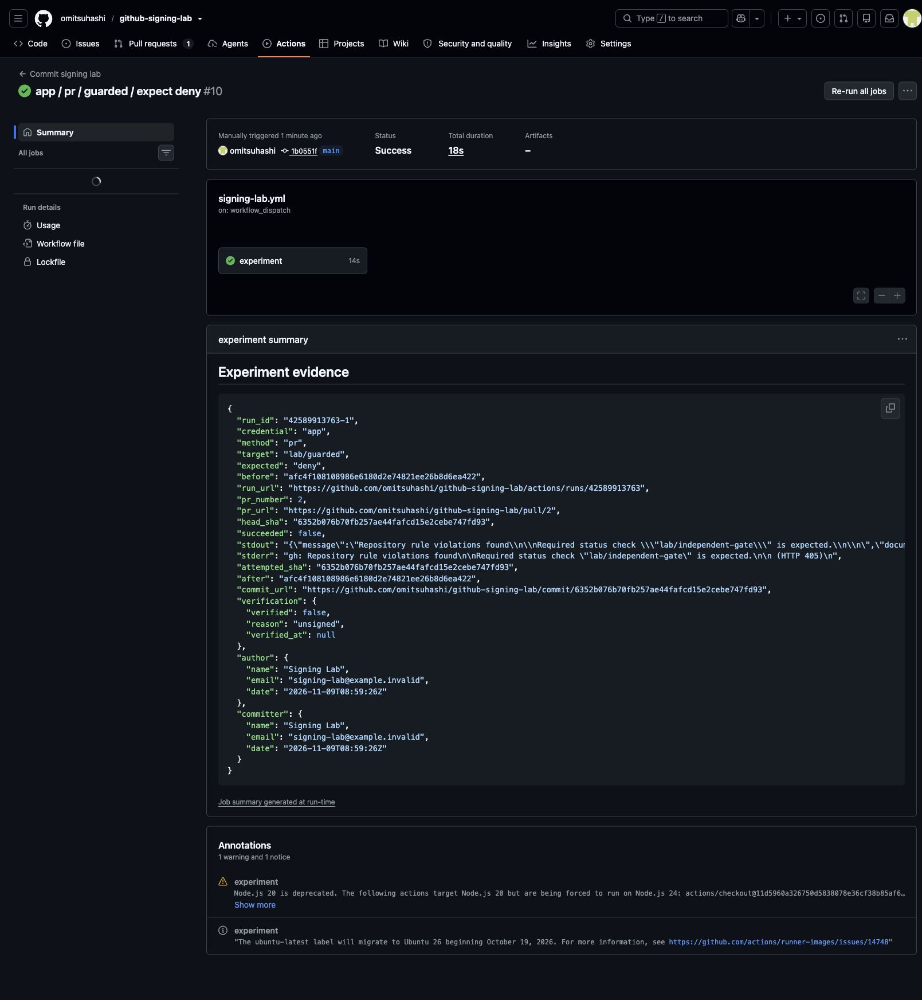
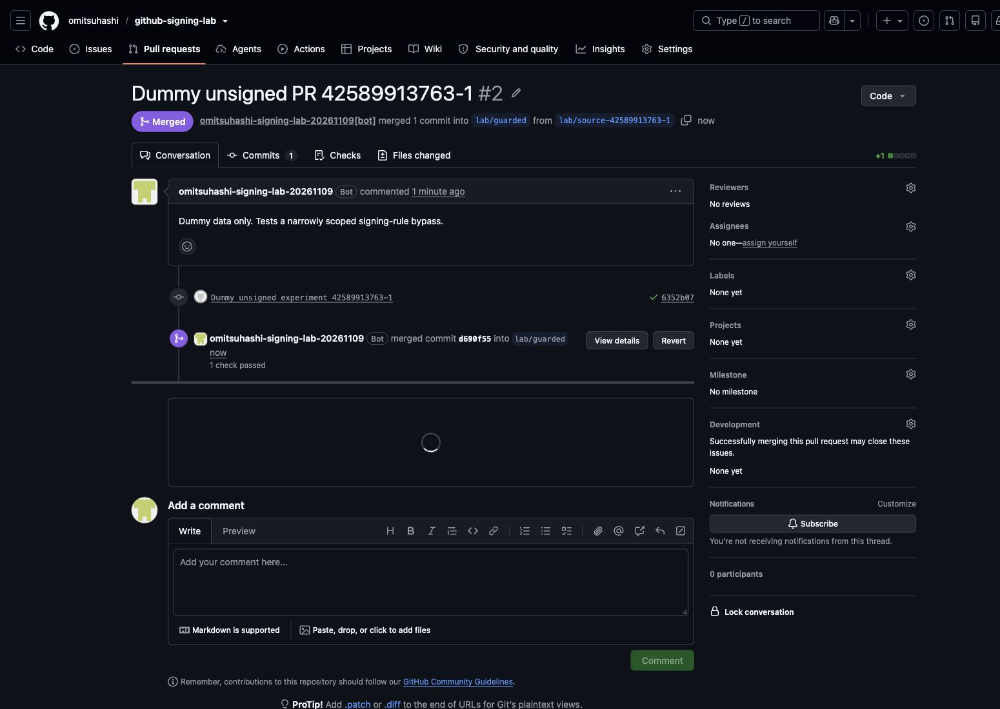
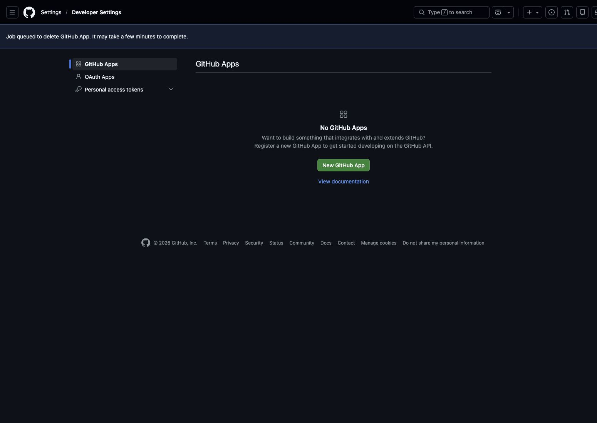

# 実測結果（2026-11-09 JST）

**対策1・対策2を実際の GitHub Actions で検証し、11件すべて期待どおりの結果を確認しました。**
公開の検証リポジトリでダミーデータだけを使用しています。

## 対策1：API で署名付きコミットを作る

署名必須 Ruleset は **Active**、対象は `lab/signed`、Bypass list は空です。

| 認証と操作 | 実測結果 | コミットの署名 | 証跡 |
|---|---|---|---|
| GITHUB_TOKEN / 未署名 git push | 拒否 | 対象ブランチ未反映 | [実行 #42584416638](https://github.com/omitsuhashi/github-signing-lab/actions/runs/42584416638) |
| GITHUB_TOKEN / Contents API・1ファイル | 成功 | Verified | [実行 #42584456383](https://github.com/omitsuhashi/github-signing-lab/actions/runs/42584456383) |
| GITHUB_TOKEN / GraphQL・2ファイル | 成功 | Verified | [実行 #42584480159](https://github.com/omitsuhashi/github-signing-lab/actions/runs/42584480159) |
| 専用 App / Contents API・1ファイル | 成功 | Verified | [実行 #42590144214](https://github.com/omitsuhashi/github-signing-lab/actions/runs/42590144214) |
| 専用 App / GraphQL・2ファイル | 成功 | Verified | [実行 #42589498009](https://github.com/omitsuhashi/github-signing-lab/actions/runs/42589498009) |

- 未署名 push は `GH013` と `Commits must have verified signatures` で拒否され、ブランチ SHA は変わりませんでした。
- Contents API と GraphQL の両方で、GITHUB_TOKEN・専用 App のいずれも `verification.verified=true`、`reason=valid` になりました。
- GraphQL の `signature.isValid` と `signature.wasSignedByGitHub` はともに `true` でした。
- GraphQL は2ファイルを1コミットとして追加できました。
- API に独自の author・committer・signature は指定していません。
- コミット署名用の GPG 秘密鍵は使用していません。専用 App の認証には別途 App 用秘密鍵を使用しました。

## 対策2：専用 GitHub App の Bypass

App: `omitsuhashi-signing-lab-20261109`（App ID: `5677810`）

- 作成者の個人アカウントだけにインストール可能な private App。
- インストール対象はこのリポジトリ1件だけ。
- Contents / Pull requests: Read & write、必須の Metadata: Read-only。
- Administration、Actions、Workflows、Secrets、Commit statuses などの権限は付与していません。
- Webhook / OAuth user authorization は使っていません。

`lab/bypass` の署名ルールだけを持つ Ruleset に、上記 App だけを登録して比較しました。

| App の設定と操作 | 実測結果 | 元コミットの署名 | 証跡 |
|---|---|---|---|
| Bypass なし / 未署名 push | 拒否 | 対象ブランチ未反映 | [実行 #42589489076](https://github.com/omitsuhashi/github-signing-lab/actions/runs/42589489076) |
| Always allow / 未署名 push | 成功 | unsigned | [実行 #42589667660](https://github.com/omitsuhashi/github-signing-lab/actions/runs/42589667660) |
| For pull requests only / 未署名の直接 push | 拒否 | 対象ブランチ未反映 | [実行 #42589769430](https://github.com/omitsuhashi/github-signing-lab/actions/runs/42589769430) |
| For pull requests only / App が PR 作成・マージ | 成功 | unsigned | [実行 #42589822868](https://github.com/omitsuhashi/github-signing-lab/actions/runs/42589822868) |

**Bypass は署名を追加しません。** Always allow の push は `Bypassed rule violations` と表示されて成功し、
そのコミットは `verification.verified=false` / `reason=unsigned` のままでした。

For pull requests only では直接 push が再び拒否されました。
同じ App が未署名コミットを別の保護対象外ブランチに push し、[PR #1](https://github.com/omitsuhashi/github-signing-lab/pull/1) を開いてマージすると成功しました。
ここでいう unsigned は PR が持ち込む元コミットの状態で、GitHub が作るマージコミットとは区別しています。

## 他の保護ルールが維持されるか

`lab/guarded` では次の2つの Ruleset を同時に有効にしました。

1. 署名必須：専用 App だけに For pull requests only の Bypass。
2. 必須チェック `lab/independent-gate`：Bypass list は空。

| 同じ PR #2 に対する App のマージ操作 | 実測結果 | 元コミットの署名 | 証跡 |
|---|---|---|---|
| 必須チェックが未報告 | 拒否 | unsigned | [実行 #42589913763](https://github.com/omitsuhashi/github-signing-lab/actions/runs/42589913763) |
| 同じコミットのダミーチェックを success に変更後 | 成功 | unsigned | [実行 #42590080941](https://github.com/omitsuhashi/github-signing-lab/actions/runs/42590080941) |

未報告時は HTTP 405 と `Required status check "lab/independent-gate" is expected.` で拒否され、対象ブランチは変わりませんでした。
その後、所有者の CLI 認証で**ダミーのステータス**を同じ PR head SHA に対して success として登録すると、同じ App がマージできました。
このチェックは実験用の手動ゲートであり、製品コードのテスト結果ではありません。

比較した head SHA はどちらも `6352b076b70fb257ae44fafcd15e2cebe747fd93`、[PR #2](https://github.com/omitsuhashi/github-signing-lab/pull/2) も同一です。
署名ルールの Bypass が、別 Ruleset の必須チェックを回避しないことを確認しました。

PR 画面のボタンは閲覧中の個人ユーザー権限で評価されます。App の成否は上記 Actions 内の API 応答とブランチ前後 SHA で判定しています。

## 実行手順と再現用設定

1. README とワークフローを main に配置し、main の SHA から `lab/signed`・`lab/bypass`・`lab/guarded` を作成。
2. `evidence/rules-*-created.json` の内容に相当する署名必須 Ruleset を Active に設定。初期の Bypass は空。
3. Actions → Commit signing lab → Run workflow で、認証・操作・対象・期待結果を選択。
4. 対策1は `github_token` / `unsigned` / `signed` / `deny`、および `contents`・`graphql` / `signed` / `allow`。
5. App を上記の権限・対象1リポジトリで登録・インストール。`LAB_APP_PRIVATE_KEY` Secret と `LAB_APP_CLIENT_ID` Variable を設定し、`app` 認証でも比較。
6. `evidence/rules-bypass-always.json` → `evidence/rules-bypass-pr-only.json` の順に相当する Bypass 設定へ変更し、上表の操作を実施。
7. `evidence/rules-guarded-pr-only.json` と `evidence/rules-independent-check-created.json` を同時に適用し、`pr` / `guarded` / `deny` を実施。
8. 作成された PR の head SHA にダミー必須ステータスを登録し、`merge` / `guarded` / `allow` と `pr_number` を指定して同じ PR を再検証。

JSON は API 応答のスナップショットなので、再作成 API への入力では id・node_id・URL・日時などの応答専用フィールドを除きます。
複製先では App ID とリポジトリ条件を置き換える必要があり、スクリプトの実行先制限も確認してください。

実験は前の実行が完了してから次を開始します。concurrency は実行中を中断しませんが、GitHub は古い pending 実行を新しい pending 実行で置き換えます。
最初の App Contents API 実行（42589493598）はこの待ち行列の挙動でキャンセルされました。再実行 42590144214 は成功しました。
キャンセルを失敗・成功の証拠には数えていません。全12実行のうち、有効な11実験が期待どおりに完了しました。

期待した拒否も assert するため、拒否実験は検証成功なら Actions が緑になります。
証跡 JSON にブランチ前後 SHA、署名検証結果、拒否理由、実行 URL を含めています。
main の初期配置・報告用コミットは署名ルールの検証対象外です。

## 後片付け

- 検証用に付けた App Bypass は両方の Ruleset から除去しました。全署名ルールは Active・Bypass なしです。
- Actions の App 用秘密鍵 Secret と Client ID Variable は削除しました。
- Downloads に取得した秘密鍵ファイルは削除しました。
- 未使用の1本目の App 鍵を削除後、GitHub UI が「唯一の秘密鍵は削除できない」としたため、ユーザーの承認を得て検証専用 App 自体を削除しました。これで残りの鍵も失効しています。
- App の削除受付後、元の App 設定 URL が 404 になったことを確認しました。
- App 削除後にも、App が Contents API / GraphQL で作った2件のコミットは `verification.verified=true` / `reason=valid` のままでした。
- コミット、PR、Actions ログ、Ruleset、証跡は保存しています。

検証専用 App と認証情報を削除しているので、App を使った再実行には新しい App の作成・認証設定が必要です。GITHUB_TOKEN の署名実験はそのまま実行できます。

[後片付けの確認結果](evidence/cleanup-verification.json)

## 適用範囲と一次資料

この結果は github.com のこの公開リポジトリでの実測です。本番環境の Organization ルール、追加の branch protection、GitHub Enterprise Server は検証対象外です。

- [bot の署名検証条件](https://docs.github.com/en/authentication/managing-commit-signature-verification/about-commit-signature-verification#signature-verification-for-bots)
- [GraphQL createCommitOnBranch](https://docs.github.com/en/graphql/reference/commits#createcommitonbranch)
- [Ruleset の Bypass](https://docs.github.com/en/repositories/configuring-branches-and-merges-in-your-repository/managing-rulesets/creating-rulesets-for-a-repository#granting-bypass-permissions-for-your-branch-or-tag-ruleset)
- [複数 Ruleset の適用](https://docs.github.com/en/repositories/configuring-branches-and-merges-in-your-repository/managing-rulesets/about-rulesets#about-rule-layering)
