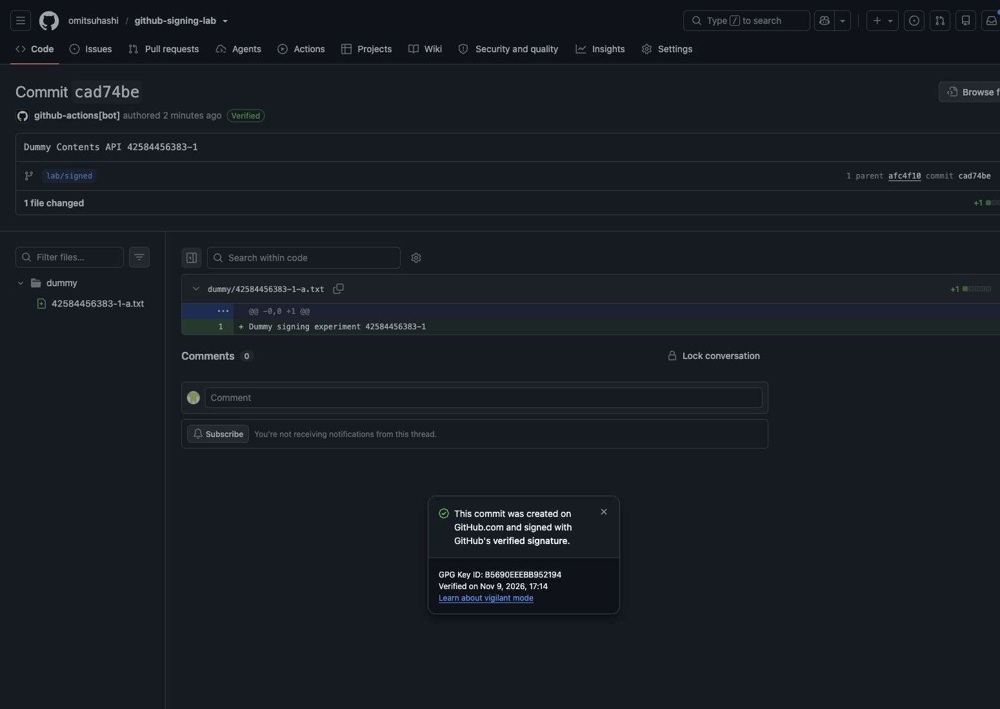

# 実測結果（2026-11-09 JST）

ダミーデータのみで、実際の GitHub Actions から実行しました。
署名必須 Ruleset は **Active**、対象は `lab/signed`、Bypass list は空です。

## 対策1：API で署名付きコミットを作る

| 認証 | 操作 | 実測結果 | verification.verified | 証跡 |
|---|---|---|---|---|
| github_token | unsigned | 拒否 | 対象ブランチに未反映 | [実行ログ](https://github.com/omitsuhashi/github-signing-lab/actions/runs/42584416638) |
| github_token | contents | 成功 | True | [実行ログ](https://github.com/omitsuhashi/github-signing-lab/actions/runs/42584456383) |
| github_token | graphql | 成功 | True | [実行ログ](https://github.com/omitsuhashi/github-signing-lab/actions/runs/42584480159) |

- 未署名 push は `GH013` と `Commits must have verified signatures` で拒否され、ブランチ SHA は変わりませんでした。
- Contents API の1ファイル更新、GraphQL の2ファイル追加はどちらも GitHub に署名され、`Verified` になりました。
- GraphQL の `signature.isValid` と `signature.wasSignedByGitHub` はともに `true` でした。
- API に独自の author・committer・signature は指定していません。
- GPG 秘密鍵は使っていません。

## 対策2：専用 GitHub App の Bypass

準備済み、App 登録時の GitHub 本人確認が完了するまで未実施です。
`lab/bypass` / `lab/guarded` の署名必須 Ruleset は有効・Bypass なしです。
`lab/guarded` には、別 Ruleset で `lab/independent-gate` を必須にしています。

## 再実行

Actions → Commit signing lab → Run workflow から、認証・操作・対象・期待結果を選択します。
`github_token` / `unsigned` / `signed` / `deny` が拒否の確認です。
`github_token` / `contents` または `graphql` / `signed` / `allow` が署名の確認です。

期待した拒否を assert するため、拒否実験も検証成功なら Actions は緑になります。
証跡の JSON にはブランチの前後 SHA、署名検証結果、拒否理由と実行 URL を含めています。

## 適用範囲

この結果は github.com のこの公開リポジトリでの実測です。
本番環境の Organization ルール、追加の branch protection、GitHub Enterprise Server は検証対象外です。
